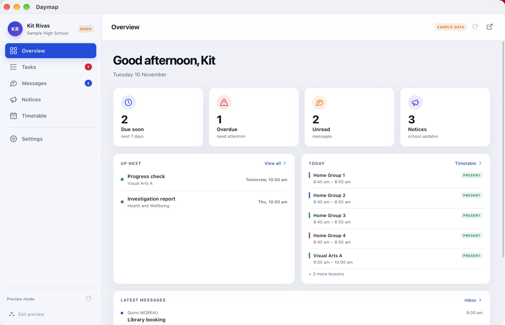
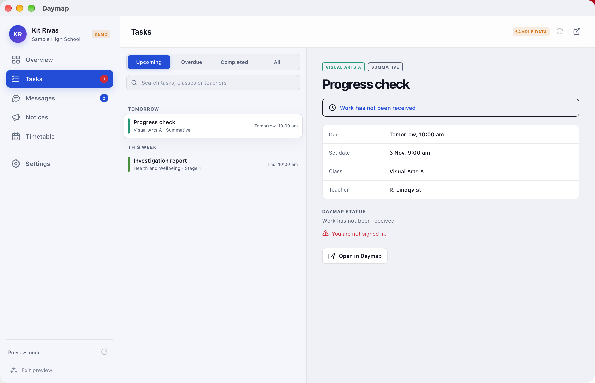
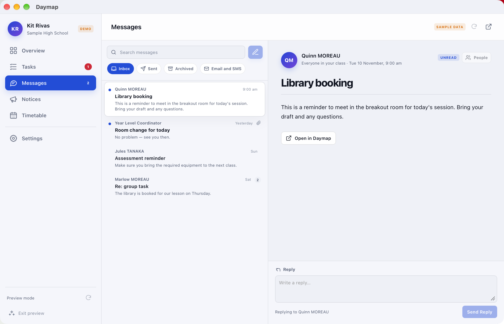
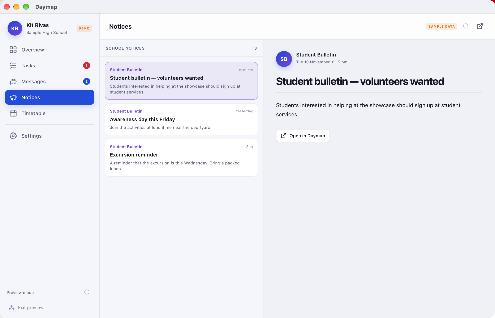
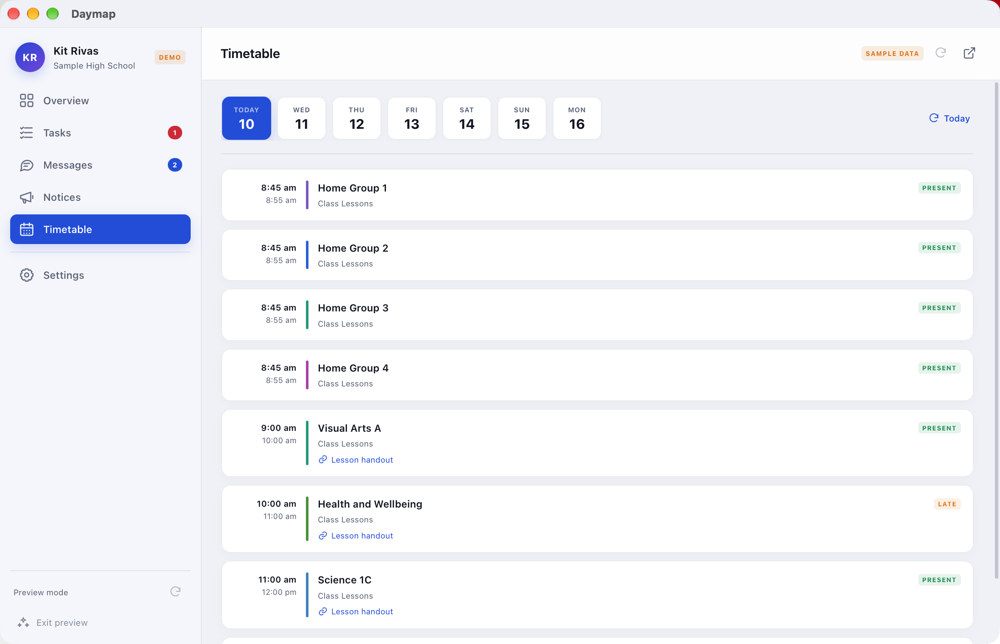
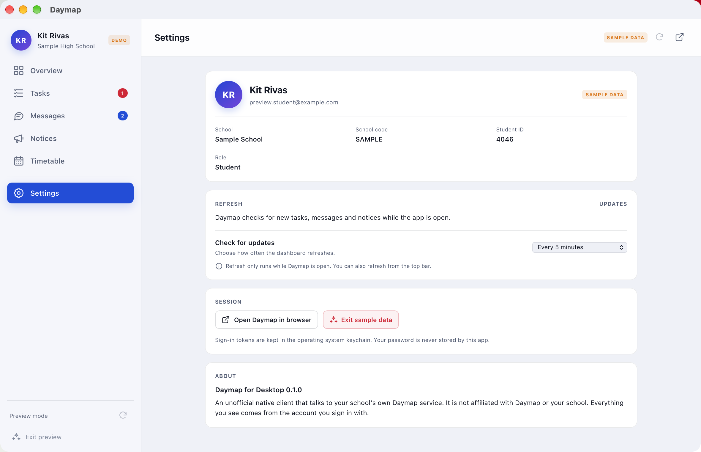

# Daymap Client

<p align="center">
  
</p>

A fast, unofficial Daymap desktop client for **macOS, Windows and Linux**, built with Tauri,
React and Rust.

> [!WARNING]
> **Unofficial client — not affiliated with, endorsed by, or supported by Daymap or any school.**
>
> - Use it at your own risk. Your school's acceptable-use policy may restrict third-party
>   clients, and this app could stop working whenever Daymap changes its API.
> - It talks to the same service your school's Daymap mobile site uses, with your own account,
>   and sends nothing to any third-party server.
> - Your password is only ever typed on your school's own login page. Tokens are held in the
>   operating system keychain by the Rust backend and never exposed to the webview.
> - No warranty of any kind. Read the code before trusting it with a school account.

## Download

[](https://github.com/Ushio-Kasana/daymap-Client/releases/latest)
[](https://github.com/Ushio-Kasana/daymap-Client/releases/latest)
[](https://github.com/Ushio-Kasana/daymap-Client/releases/latest)

Each button opens the latest release. Pick the file for your platform:

| Platform | Files |
| --- | --- |
| macOS | `.dmg` (Apple silicon) |
| Windows | `.exe` installer or `.msi` |
| Linux | `.AppImage`, `.deb` or `.rpm` |

## Release notes

See [CHANGELOG.md](CHANGELOG.md) for the changes in each release and the work
currently queued for the next one.

## Screenshots

The app's built-in preview mode, which runs on invented sample data with no school account.

| Overview | Tasks |
| --- | --- |
|  |  |

| Messages | Notices |
| --- | --- |
|  |  |

| Timetable | Settings |
| --- | --- |
|  |  |

## Features

Working today:

- ✅ Sign-in with your school's own Daymap / EdPass account in an embedded webview.
- ✅ Session kept in the operating system keychain, with tokens never exposed to the UI.
- ✅ Overview with due-soon, overdue, unread and notice counts.
- ✅ Tasks with search, filters, grouping and full task details.
- ✅ Assignment resources with downloads, and work uploads through Daymap's own upload flow.
- ✅ Day and Week timetable views with rooms, teachers and substitutes, and a week picker.
- ✅ In-app update checks against GitHub releases, with download progress and the matching platform installer.
- ✅ Messages with folders, search, compose, replies and file attachments.
- ✅ Contact search across staff, students and parents.
- ✅ School notices with a reading view.
- ✅ A token-free offline cache, so the last dashboard still opens without a connection.
- ✅ A sample-data preview mode for looking around without an account.
- ✅ One codebase that builds for macOS, Windows and Linux.

Planned for later sessions:

- ☐ Colour themes and appearance customisation.
- ☐ Native desktop notifications for new tasks, messages and notices.
- ☐ Contact export (CSV).
- ☐ Optional menu-bar / tray behaviour.
- ☐ Richer attachment previews inside messages.

See [TODO.md](TODO.md) for the full working list, including reported bugs and
platform build targets.

## Development

Requirements:

- Node.js 20 or newer.
- Rust 1.77.2 or newer.
- The usual Tauri platform prerequisites. On Linux, install WebKitGTK 4.1, libdbus, libsecret
  and the other Tauri build dependencies for your distribution; the CI workflow lists the Ubuntu
  packages.
- macOS: Xcode command line tools.
- Windows: WebView2 runtime (installed by default on current Windows 10/11) and the MSVC
  build tools.

From this directory:

```bash
npm install
npm run tauri dev
```

For a browser-only interface preview:

```bash
npm run dev
```

The browser preview starts in sample-data mode. Native sign-in is intentionally unavailable
outside the desktop shell because it needs the embedded webview and the Rust keychain bridge.

### Build installers

```bash
npm run tauri build
```

Tauri writes platform bundles under `src-tauri/target/release/bundle/`:

- Windows: NSIS `.exe` and MSI.
- Linux: `.deb` and `.AppImage` (depending on the installed bundler tools).
- macOS: `.app` and `.dmg`.

macOS DMGs use `src-tauri/assets/dmg-background.png`, 128 px app icons and a compact
560×320 drag-to-Applications window. The release workflow explicitly keeps Tauri's
Finder layout enabled on CI so those settings are included in published installers.

Windows and Linux installers should be produced on their respective operating systems, or
through the included GitHub Actions workflow. The workflow is manual-only: dispatch **Build
desktop apps** from `main` to build all three platforms. Leave `release_tag` empty for test
artifacts, or set it to a version tag to publish flat installers to a release using the matching
`CHANGELOG.md` section as the release body. Branch and tag pushes do not trigger a build.

### Update checks

The desktop app asks the public GitHub Releases API for the latest published release at startup
and when you choose **Check for updates** in Settings. If the tag is newer than the running
version, the app offers the matching installer for the current platform.

Daymap downloads the installer into your Downloads folder and shows byte/percentage progress in
the update banner and Settings. It checks the file against GitHub's SHA-256 asset digest when one
is provided. When the download finishes, Daymap opens the installer with the operating system and
quits so the installer can replace it.

On macOS this opens the DMG. If macOS asks whether Daymap can access your Downloads folder,
choose Allow. Drag Daymap into Applications, replace the old copy, then reopen it. On Windows and
Linux, follow the installer or package prompts, then reopen Daymap. If no matching installer is
available, Daymap opens the GitHub release page instead.

This flow relies on GitHub's HTTPS and release account security. It does not verify an app-level
update signature, so only run releases published from this repository. GitHub's unauthenticated
API allows 60 requests per hour per IP; normal use is one request per launch or manual check.

To publish an update, bump the version in `package.json`, `src-tauri/Cargo.toml` and
`src-tauri/tauri.conf.json`, move the relevant `CHANGELOG.md` entries under the new version,
then commit and push `main`. Run **Build desktop apps** from `main` with `release_tag` set to the
matching version tag. The workflow publishes the installers and creates the release the app will
offer.

### Sign-in and security

- The password is entered only on the school's Daymap/EdPass page in the embedded webview.
- Access and refresh tokens stay in Rust. The React layer only receives profile/dashboard data.
- The session is stored as one JSON value in the operating system keychain.
- On macOS, reopening a saved session asks for Touch ID when biometrics are
  enrolled, with the login password as the system fallback. **Require Touch ID**
  in Settings turns this off; it is on by default. Without biometrics, the normal
  keychain prompt is used. This is an app-level unlock; the keychain still
  protects the saved tokens.
- Settings → **Clear keychain and cache** signs out, removes the saved session from
  the operating system keychain, and deletes all offline data. Your Daymap account is not
  changed.
- The app does not log tokens. Keychain failures are reported locally without printing the
  session contents.
- HTTPS validation uses the operating system's certificate store, including school-installed
  private CAs installed by some schools. A Windows or Linux machine must trust that CA too.
- Linux requires a working Secret Service provider (GNOME Keyring, KWallet with the Secret
  Service bridge, or equivalent). Without one, the app can still run for the current session but
  it cannot persist sign-in across restarts.

The OIDC callback is detected by the native webview's navigation handler. Third-party SSO
providers that open a separate popup window may require additional handling; this needs testing
against each school's identity provider.

### Architecture

```text
src/                 React UI
  App.tsx            session lifecycle and auth events
  components/        login, shell, overview, tasks, messages, notices, timetable, settings
  dates.ts           Daymap date parsing and display helpers
  demo.ts            sample dashboard
  updater.ts         GitHub release checks, download progress and installer hand-off

src-tauri/src/
  auth.rs            discovery, PKCE, auth window, token refresh, keychain
  api.rs             authenticated Daymap requests and dashboard normalization
  assignments.rs     task detail, resources, downloads and work uploads
  messages.rs        message folders, threads, contacts, replies, compose and attachments
  updates.rs         update download, progress events, installer launch and app quit
  cache.rs           account-scoped offline dashboard, mailbox and contact cache
  models.rs          bridge models shared with the frontend
```

The API calls are made by Rust rather than the browser, so the webview never handles bearer
tokens and the Daymap endpoints do not need browser CORS support.

### Verification status

Verified locally on macOS:

- `npm run build` (TypeScript and Vite production build).
- `cargo check` for the Rust backend.
- macOS Keychain round-trip through `keyring` (write, read and delete).
- Discovery against a school's Daymap host succeeds using the operating system trust store.
- `npx tauri build --debug --no-bundle`.
- `npx tauri build --debug` produced a macOS app bundle and DMG on the local machine.
- Styled macOS DMG build with a 560×320 Finder window, 128 px icons, arrow background and
  app/Applications positions applied under `CI=true`.
- Browser sample mode: overview, tasks, messages, notices, timetable and settings rendered
  without console errors or horizontal overflow; compose and message-detail states were checked.
- Update checks against the live GitHub release, an up-to-date state, and a mocked newer release
  with the matching platform download label and installer URL.
- Native macOS update download/progress, digest-complete hand-off, DMG mount and quit, using a
  local test build that reported an older version so v0.1.2 appeared as an update.
- Real sign-in: dashboard, tasks, timetable, notices and messages load against a live account.

Not verified here:

- Message attachments end to end: the upload uses Daymap's SAS flow, but the exact purpose name
  and attachment field are inferred and need a live send to confirm.
- A complete assignment upload from start to finish (the fix for the task detail response has
  been built, but sending student work needs a file you are happy to submit).
- Windows and Linux compilation and installers. Build those through the included workflow or on
  native machines.
- Linux Secret Service availability at runtime.
- An end-to-end upgrade from 0.1.2 to 0.1.3 after publication. The native download, progress,
  DMG mount and quit flow was exercised with a local test build against v0.1.2, but has not yet
  been run against the published 0.1.3 release.

### Privacy gate

Commits and pushes are scanned for credentials, personal details and the names and codes listed in
`scripts/sensitive-terms.local`:

```bash
scripts/install-hooks.sh                            # once per clone
python3 scripts/sensitive_gate.py --staged          # what pre-commit runs
python3 scripts/sensitive_gate.py --all-history     # what pre-push and CI run
```

The term list is gitignored, so the identities it protects never enter the repository.The `Sensitive data gate` workflow repeats the scan on every push to `main`, including bypassed hooks.
